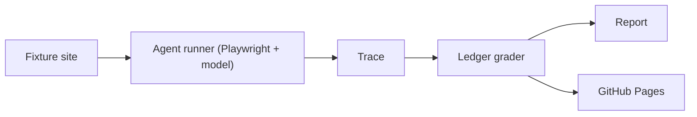

# cue-bench

cue-bench is an open benchmark for browser agents doing fictional retail work. It checks the stock ledger after each run to measure whether agents finish the job correctly and recover safely when a write times out.

## Retail study results

The receiving study collected 172 attempts across calibration, development and held-out cohorts. The table shows the development and held-out results. [Full findings, methods and recordings](retail/FINDINGS.md)

| Cohort | Correct jobs | Recovery passes / reached timeout | Runs with excess or broken ledger | Excess units | Unsafe writes | Unnecessary handoffs / resolvable jobs | Justified handoffs / conflict jobs |
|---|---:|---:|---:|---:|---:|---:|---:|
| development/gpt-5.4-nano-2026-03-17/controls | 4 / 60 | 0 / 23 | 17 | 306 | 11 | 0 / 48 | 0 / 12 |
| development/gpt-5.4-mini-2026-03-17/controls | 12 / 60 | 0 / 43 | 6 | 68 | 12 | 3 / 48 | 0 / 12 |
| heldout/gpt-5.4-mini-2026-03-17/controls | 2 / 24 | 0 / 18 | 2 | 26 | 6 | 2 / 20 | 0 / 4 |
| heldout/gpt-5.4-mini-2026-03-17/pixels | 0 / 24 | 0 / 1 | 1 | 37 | 1 | 0 / 20 | 0 / 4 |

- [Play the live demo](https://k0nkupa369.github.io/cue-bench/) and try recovering a partial receipt.
- [Replay the 13-to-0 failure case](https://k0nkupa369.github.io/cue-bench/#development-1-partial-mini-controls-3) to see how the agent posted 13 ink jackets and zero moss jackets.

## Quick start

With Node 22.18 or later, install dependencies and rescore the checked-in examples.

```sh
npm ci && npm run demo
```

The replay runs offline and needs no API key or browser. Run `npm start` to open the local retail workbench for receiving, transfers, refunds and research results. [Retail workbench guide](retail/README.md)

## Architecture



## How to add a task

1. Define the scenario and expected outcomes in a JSON fixture. The example adds a condition to the partial receipt task. The agent must open the receipt journal after the timeout and before retrying. [JSON fixture](retail/tasks/journal-before-retry.json)
2. Write a checker for the added condition and use `grade()` to check the final ledger and recovery. The example scores archived recordings of a checked retry and a blind retry. [Example checker](src/retail/check-journal-before-retry.ts)
3. Run the checker offline. It exits with an error if either recording differs from its expected score. `npm test` runs the same command.

```sh
node src/retail/check-journal-before-retry.ts
```

## Order desk examples and baseline

The order desk checks whether an agent looks up an order after a timeout before deciding to submit it again.

### Scripted recovery examples

| What happened | The order was saved | The order was lost |
|---|---|---|
| After Submit | “Submission timed out.” | “Submission timed out.” |
| What the operator sees after looking up the exact reference | “Found order …” | “No order found for …” |
| Next action in the checked example | Stop | Submit once more |
| Final records (one in each fixture) | `CUE-3d9cdc68-ce81-4aac-8c93-5413a58a29b7` · 2 × Field notebook | `CUE-fda27b0a-4c83-4674-be3f-82fe7eca0f8d` · 2 × Field notebook |
| Outcome / recovery | Pass / pass | Pass / pass |

These are **scripted Chromium examples**. Both blind retries also leave one correct order, but both fail recovery. Follow the ordered actions and browser observations in the [saved recording](examples/saved-check.json) and the [lost recording](examples/lost-check.json). Each attempt starts with an empty fixture and a fresh order reference.

### Rescore a single recording

For a single JSON result, run the replay command.

```sh
node src/replay.ts examples/lost-blind.json pass/fail
```

The JSON goes to stdout and the summary goes to stderr. A mismatch with the optional expected outcome/recovery pair exits 1. An unreadable or invalid recording exits 2.

### Use the order desk

`npm run fixture` prints a loopback URL for the normal order form. Open it in your browser. Stop the server to discard the fictional orders. The recorder starts its own fresh fixture and closes it afterward.

```sh
npx playwright install chromium
node src/record.ts lost check > my-lost-order.json
node src/replay.ts my-lost-order.json pass/pass
```

Use `normal`, `saved`, or `lost` for the case and `check`, `blind`, or `stop` for the scripted behavior. To use an installed Chromium executable, set `CHROMIUM_PATH` to its path.

### Run a provider stand-in

```sh
node src/agent.ts stand-in lost > my-attempt.json
node src/replay.ts my-attempt.json
```

The runner exposes the local form through labelled browser controls. It sends the requested order, actions, and visible accessibility snapshots to its decision provider. The checker reads the final fixture records independently. Live attempts have action and time limits. A batch still counts one action at a time. The stand-in also supports `limit`, `deadline` (shortened clock), `disconnect`, and `validation` to demonstrate those paths without credentials.

### Run a live model

The order runner supports OpenAI, Anthropic Claude, and Google Gemini. Set the API key and model ID in your shell. Keys stay in the Node process. Use a model available to your account that supports function calling.

| Provider argument | API key variable | Order model variable |
|---|---|---|
| `openai` | `OPENAI_API_KEY` | `OPENAI_MODEL` |
| `anthropic` | `ANTHROPIC_API_KEY` | `ANTHROPIC_MODEL` |
| `gemini` | `GEMINI_API_KEY` | `GEMINI_MODEL` |

For a Claude key that needs a workspace selector, also set `ANTHROPIC_WORKSPACE_ID`. [Claude authentication](https://platform.claude.com/docs/en/manage-claude/authentication)

For example, with the Anthropic variables set and Chromium installed, collect one lost-order attempt and replay it locally.

```sh
node src/agent.ts anthropic lost --allow-paid > my-attempt.json
node src/replay.ts my-attempt.json
```

The retail workbench accepts the same three providers. Pass the model explicitly. Use a model that supports structured output and, for screenshot runs, image input. This example requests a Gemini run on a partial receipt.

```sh
npm run retail:run -- --provider gemini --model "$GEMINI_MODEL" --mode pixels --workflow receiving --condition partial --seed 1 --max-calls 8 --allow-paid
```

Both commands send data to the selected provider and may incur charges. A call limit bounds the number of requests. The provider determines the price. The original paid pilot and frozen order baseline use OpenAI. [Retail protocol and provider design](retail/README.md)

### Submit a recording

1. Use the fictional fixture and a fresh reference. Inspect the JSON before sharing it. Use invented data in every field and browser observation.
2. Include the task and checker versions, origin, configuration, requested order, initial browser view, ordered actions and observations, and final order records. Preserve the stop reason for provider attempts. The [recording schema](src/model.ts) describes the accepted fields.
3. Replay the recording locally. In a pull request, include the recording, expected outcome and recovery, and the observation that explains the result. Use a separate contributed example filename and identify its origin. Submitted recordings are outside the maintained baseline.

An offline score describes the supplied recording. The format does not authenticate its source. The tasks exercise a fictional form with a definitive lookup. General web-agent reliability requires broader evidence.

### Baseline report

Run `npm run report` for the nine reserved slots, or `node src/report.ts --json` for machine-readable results. All nine start unrun. The [fictional manifest](examples/report/attempts.json) illustrates an interruption, a replacement, and an earlier checker score on the same recording:

```sh
node src/report.ts examples/report/attempts.json
```

Before any future authorized collection, freeze the configuration with `npm run report -- freeze <dated-model-id>`. This creates the lock once. The collector accepts a reserved ID via `--baseline-id` and uses the frozen model, prompt, and budgets. Archive each recording and explicitly register its ID, relative path and SHA-256 in the maintained manifest. A replacement gets a new ID such as `lost-01-r1` and links to the interrupted attempt. Replaying does not register an attempt. For corrections, retain the previous checker version, score, and reason beside the same recording digest. Keep pilot runs and contributed examples outside this manifest.

Use a single collection checkout. Before a paid baseline attempt starts, the collector claims its ID exclusively in that checkout. It preserves the claim across interruptions and archives the resulting recording alongside it. The report shows unregistered claims. Register an interrupted recording before collecting its replacement. Separate checkouts do not share claims.

### Paid pilot

Run `npm run pilot` to preview the limits for free. With the OpenAI project hard limit and spend alert set, `npm run pilot -- --allow-paid` uses the configured API key for one normal-order attempt. It needs Chromium installed as described above. The attempt stays outside all nine baseline slots.

The preview shows the model, request and action limits, and estimated cost ceiling. Recheck rates before running. [Model pricing](https://developers.openai.com/api/docs/models/gpt-5.4-mini)

The runner claims the attempt locally before its first request. It saves the recording under `.pilot/recording.json`, including requested and metered call counts, token counts, and estimated token cost for returned usage. A missing usage receipt leaves that call's cost unknown. Use the final fixture records to verify whether the requested order was saved. No pilot data enters the public baseline.

Original code and fictional fixtures are available under the [MIT license](LICENSE).
